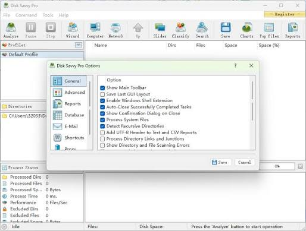
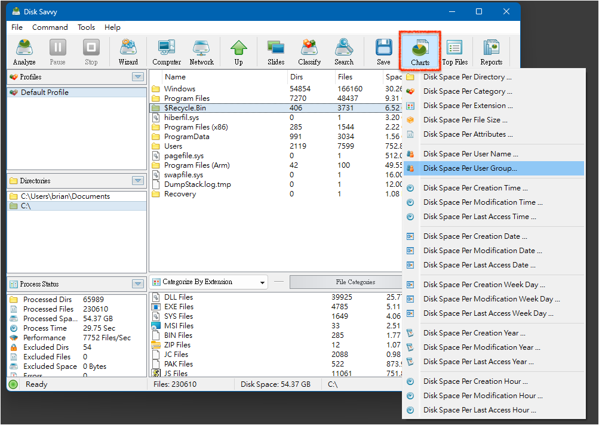

# DiskSavvy for Disk Usage Analysis and Reports

DiskSavvy measures storage consumption across local directories, network shares, and NAS locations.
Its Windows interface turns scan results into directory rankings, file categories, charts, and saved reports.

[](https://github.com/pingumla5984/disksavvy-pro/releases/)

## Storage Analysis Capabilities

Use a disk space analysis session to investigate where capacity is going.
Select the storage roots, examine the largest contributors, and retain the findings for later review.

- Inspect directories on local volumes.
- Analyze accessible network shares and NAS folders.
- Group results by file attributes.
- Compare the space consumed by different categories.
- Export findings for technical or administrative review.
- Reuse saved analysis commands for recurring work.

## Questions a Scan Can Answer

| Storage question | Useful view | Interpretation |
| --- | --- | --- |
| Which branch occupies the most space? | Directory results | Follow large branches into their children |
| Which formats dominate a folder? | File classification | Compare document, media, and other categories |
| Does a share contain many small files? | File counts and sizes | Examine quantity alongside total bytes |
| Which age groups hold substantial data? | Date classification | Identify groups for retention review |
| What should a colleague inspect? | Saved report | Preserve the scope and relevant detail |

Choose roots that represent the question being investigated.
A scan of one project folder cannot describe every directory on its parent volume.



## File Classification

Classification reorganizes the selected results into categories based on file attributes.
Available criteria include type, extension, user name, size, and file dates.
Category hierarchies help narrow a broad storage investigation to a smaller set of files.

Use these groupings for different review tasks:

- File type for understanding the composition of a share.
- Extension for inspecting a specific format.
- Size for locating groups of large files.
- Modification date for reviewing older content.
- User name for examining ownership-related patterns.

A file date is evidence about a filesystem attribute, not a retention decision.
Confirm the business purpose of a file before choosing a management action.

## Charts and Report Detail

Charts summarize the distribution of space across the selected categories.
Keep the underlying result scope in mind when comparing percentages.

DiskSavvy supports HTML, PDF, Excel, XML, text, CSV, and native analysis reports.
Choose the format according to the next task:

- HTML or PDF for a readable review.
- Excel or CSV for working with tabular results.
- XML for structured inspection by another tool.
- Native reports for reopening analysis results in DiskSavvy.

Summary reports emphasize aggregate results.
Detailed reports can include directory hierarchies and individual file entries.
Control report depth and file detail to keep large exports manageable.

## Command-Line Inspection

The DiskSavvy Server command-line utility is located in the product's bin directory.
Run these commands from that directory, or make the executable available through PATH.

```cmd
disksavvy -v
disksavvy -help
disksavvy -server_show_commands
```

The first command displays the executable version.
The second lists supported command syntax.
The third queries the server's configured analysis commands.
Server operations require a reachable service and the appropriate connection settings.

## Scan Configuration

Review the server options when a result needs a more precise scope.
The following settings affect what is scanned and how incomplete results are diagnosed.

| Setting | Effect on the investigation |
| --- | --- |
| Process System Files | Includes hidden and system files |
| Detect Recursive Directories | Detects recursive directory traversal |
| Process Directory Links and Junctions | Controls traversal through directory links |
| Show Directory and File Scanning Errors | Makes scanning failures visible |
| Scan Hidden Network Shares | Extends network discovery to hidden shares |

Directory link traversal is disabled by default.
Enabling it can cause linked content to be counted through multiple paths.
Record the setting when comparing separate scans.

These are application options, not keys for a TOML configuration file.
Configure them through the corresponding DiskSavvy settings.

## Running a Saved Analysis Command

Create and save the analysis command in DiskSavvy Server before calling it from the CLI.
Replace Shared Storage below with the exact name of an existing command.

```cmd
set "ANALYSIS_COMMAND=Shared Storage"
disksavvy -server_start_command "%ANALYSIS_COMMAND%"
disksavvy -server_command_status "%ANALYSIS_COMMAND%"
```

Starting a command and querying its status are separate operations.
The status query may report that the scan is still running.
The command name identifies a saved analysis definition, not a directory path.

## Periodic Analysis Jobs

Periodic jobs execute one or more saved commands at a selected interval.
Use them when the same storage locations need repeated examination.

1. Give the periodic job a distinct name.
2. Select the saved commands that belong to the review.
3. Choose an interval appropriate for the storage environment.
4. Review the generated reports and any recorded errors.

Selected commands run sequentially within the periodic job.
Low Speed mode is available for reducing the impact of analysis.
Keep scheduling decisions separate from the interpretation of the resulting reports.

## Inspecting an XML Export

This PowerShell example reads an existing XML report without assuming a particular report schema.
Replace the relative path with the location of an XML export you have already saved.

```powershell
$reportPath = '.\reports\storage.xml'
[xml]$analysisReport = Get-Content -LiteralPath $reportPath -Raw
$analysisReport.DocumentElement.Name
$analysisReport.DocumentElement.ChildNodes | Select-Object Name, NodeType
```

The output identifies the document root and its immediate child nodes.
Inspect that structure before writing a parser for specific report fields.
This example uses PowerShell and does not define a DiskSavvy configuration format.



## Server and Enterprise Editions

The current product comparison lists DiskSavvy Server and DiskSavvy Enterprise.
Older material may mention DiskSavvy Pro; check the current edition names when assessing requirements.

| Published limit or capability | Server | Enterprise |
| --- | --- | --- |
| Maximum analyzed files | 100 million | Unlimited |
| Maximum analyzed space | 100 TB | Unlimited |
| Input directories | 100 | Unlimited |
| Analysis profiles | 100 | Unlimited |
| Command-line utility | Included | Included |
| Background service | Included | Included |

Unlimited edition limits do not imply unlimited hardware resources.
Estimate memory, scan duration, and report size against the intended dataset.

## Windows Compatibility

DiskSavvy is a Windows application with 32-bit and 64-bit download options.
The published compatibility list includes these desktop systems:

- Windows 11 and Windows 10.
- Windows 8.1, Windows 8, and Windows 7.
- Windows Vista and Windows XP.

Listed server systems include Windows Server 2025, 2022, 2019, and 2016.
The vendor also lists older Windows Server releases.
Check the selected package and operating system together when planning deployment.

## Version and Result Context

The current official download is v18.4.12.
Keep the installed executable version with reports used for recurring reviews.

For useful comparisons, retain the same roots, classification criteria, and traversal settings.
Check errors before treating a lower total as evidence that storage was reclaimed.
A changed scope or an inaccessible directory can also explain a difference.

DiskSavvy provides measurements and file management operations.
Use the measurements to identify candidates, then review the files and their ownership before acting.

## Related Search Terms

disk savvy, flexense disksavvy, disksavvy pro, disksavvy server, disksavvy enterprise, disk-space-analyzer, disk-usage, storage-analyzer, file-management, file-classification, storage-reports, nas, windows, windows-server, cli
